# superstore_sales_analysis
Exploratory Data Analysis (EDA) and Profitability Insights on the Sample Superstore dataset using Python and Pandas
# Superstore Sales Analysis
Exploratory Data Analysis (EDA) and Profitability Insights on the Sample Superstore dataset using Python and Pandas.

## Executive Summary
- **Dataset Scope:** 9,994 transaction records across the Kaggle Sample Superstore dataset.
- **Key Metrics:** 
  - Mean Sales: **$229.86**
  - Mean Profit: **$28.66**
- **Core Insight:** High sales volume does not guarantee net profit. Heavy discounting (>20%) on specific sub-categories like Tables and Bookcases leads to significant margin bleed.

## Visual Gallery
### 1. Monthly Sales Trend
*(Upload your monthly trend chart and add image link here)*

### 2. Sales vs. Profit Scatter Plot
*(Upload your scatter plot and add image link here)*
# Superstore Sales, Profitability, and Customer Trend Analysis
**Author:** Nasiha M S (Batch: DA55)

## Abstract
This project provides an in-depth analysis of retail sales, profitability, and customer purchasing behaviours using the Sample Superstore dataset. The primary purpose is to identify revenue drivers, analyse product category performances, and uncover operational bottlenecks such as heavy discounting leading to financial losses[cite: 2].

---

## Executive Summary & Key Metrics
- **Dataset Scope:** 9,994 transaction records across 21 columns (Kaggle Sample Superstore)[cite: 2].
- **Tech Stack:** Python (Pandas, NumPy, Matplotlib, Seaborn, Plotly) in Google Colab / Jupyter Notebook[cite: 2].
- **Key Findings:** High-gross sales categories do not automatically guarantee profitability. Aggressive discounting exceeding 20% to 30% severely erodes margins, leading to heavy financial losses in sub-categories like Tables, Bookcases, and Supplies[cite: 2].

---

## Complete Project Visual Gallery & Charts

### 1. Category & Regional Sales Bar Charts
* **Total Sales by Category & Region:** Technology ($836k) and Furniture ($742k) dominate gross sales, while the West region leads in performance[cite: 2]
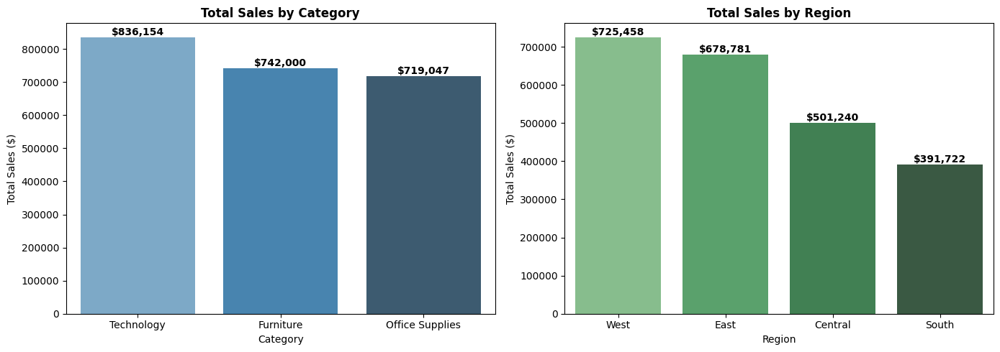

### 2. Monthly Sales Trend Line Chart
* **Monthly Sales Trend Over Time:** Displays chronological order trends revealing seasonal end-of-year sales spikes[cite: 2].
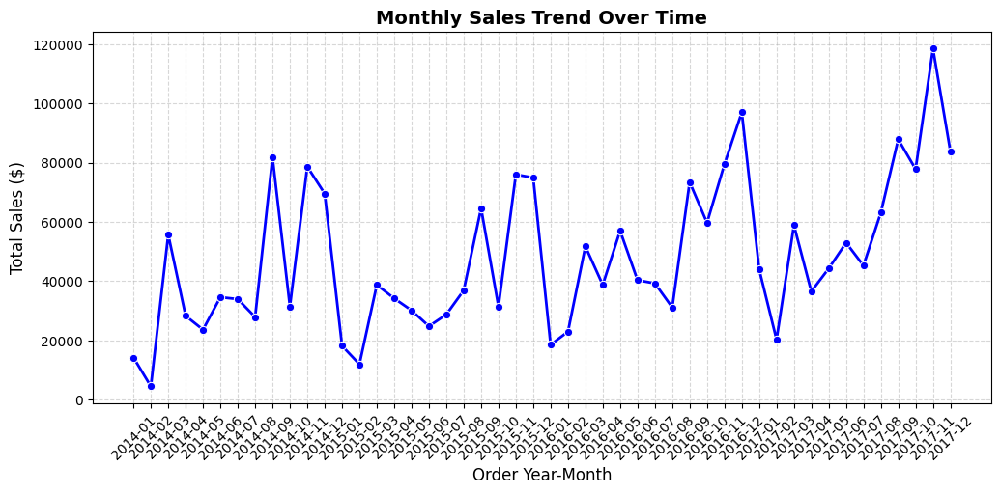

### 3. Sales Distribution Histogram & Box Plots
* **Distribution & Outliers:** Highlighted right-skewed transaction frequencies under $500 alongside severe profit loss and sales outliers[cite: 2].
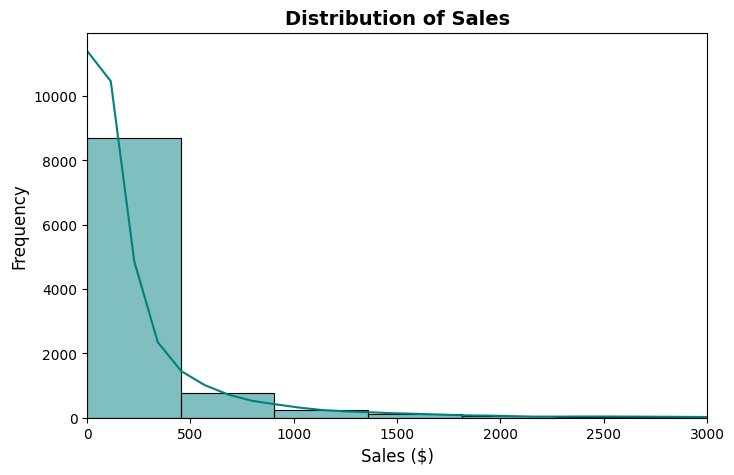
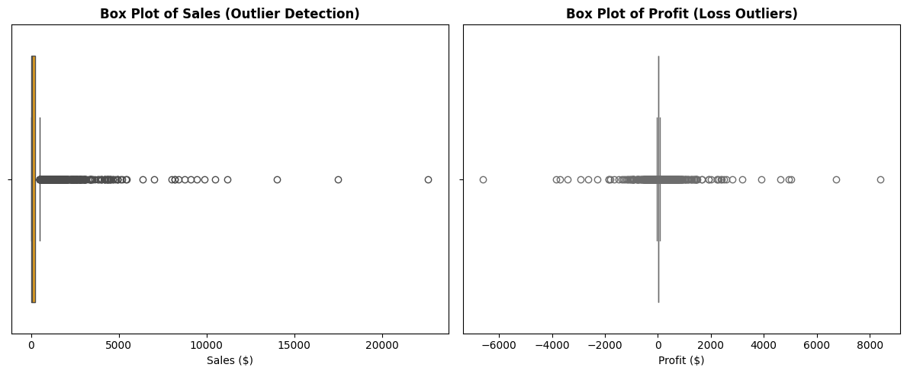

### 4. Sales vs. Profit Scatter Plot & Relationship
* **Sales vs. Profit Analysis:** Proves that a significant cluster of high-sales transactions dips below the zero-profit line due to heavy discounting[cite: 2].
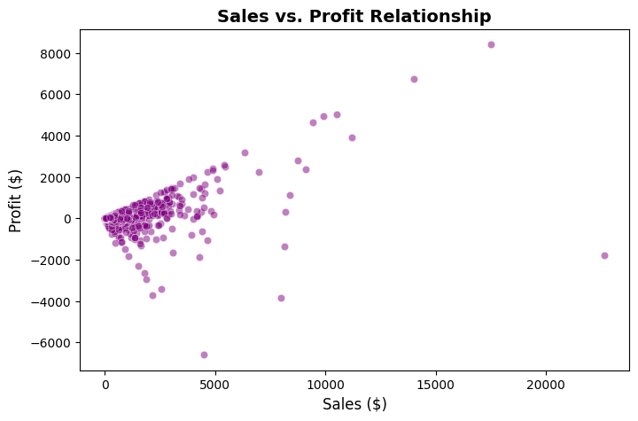

### 5. Interactive Donut Pie Chart (Plotly)
* **Sales Share Distribution:** Illustrated sales shares across Technology (~36.4%), Furniture (~32.3%), and Office Supplies (~31.3%)[cite: 2].
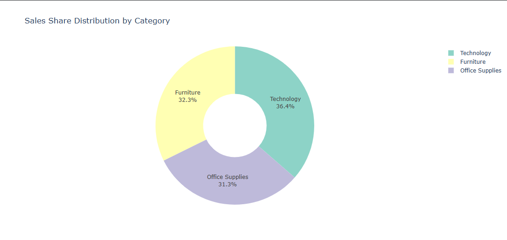

### 6. Correlation Heatmap
* **Feature Correlation:** Evaluated meaningful numerical features (Sales, Quantity, Discount, Profit, Unit Price, Profit Margin)[cite: 2].
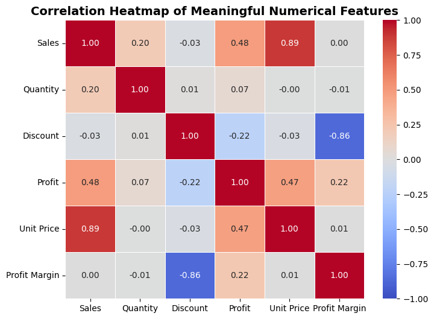

### 7. Profit by Sub-Category Bar Chart
* **Sub-Category Performance:** Highlighted that while Copiers and Phones generate stellar profits, sub-categories like Tables and Bookcases suffer heavy net losses[cite: 2].
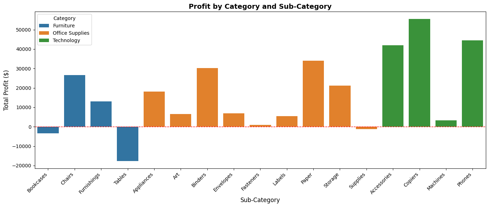

### 8. Discount vs. Profit Analysis Scatter Plot
* **Discount Impact:** Proves that discounting beyond 20%–30% drives profit sharply below zero into heavy financial loss[cite: 2].
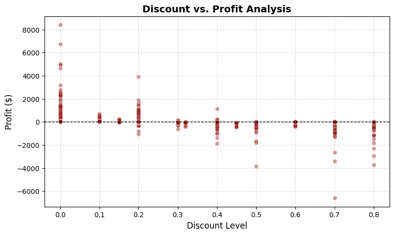

### 9. Regional Profitability Comparison Bar Chart
* **Regional Performance:** Demonstrated that the West secures the highest net profit, whereas the Central region lags behind its sales volume due to excessive discounting[cite: 2].
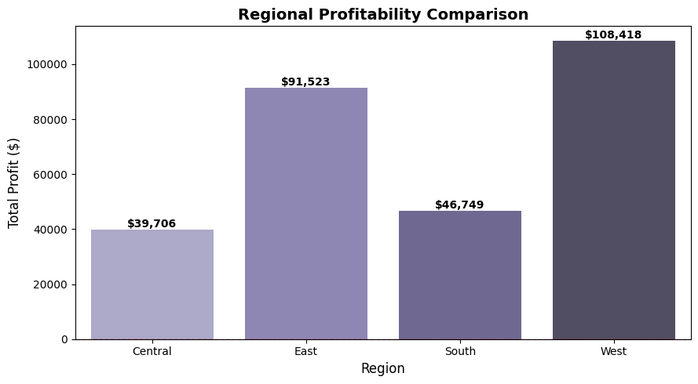

### 10. Top 10 Products by Sales Bar Chart
* **Top Revenue Products:** Identified premium office equipment and Cisco TelePresence systems as top gross revenue drivers[cite: 2].
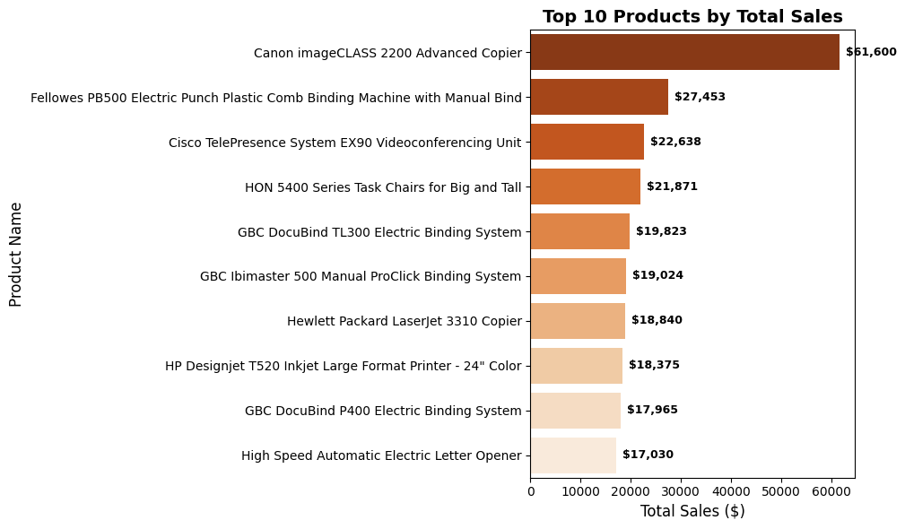
